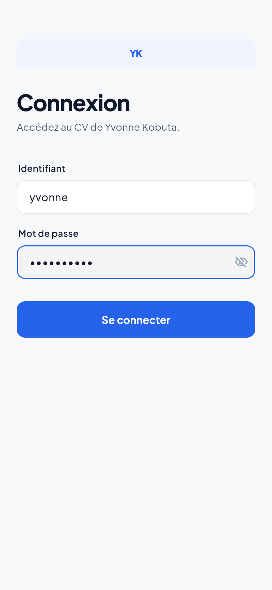
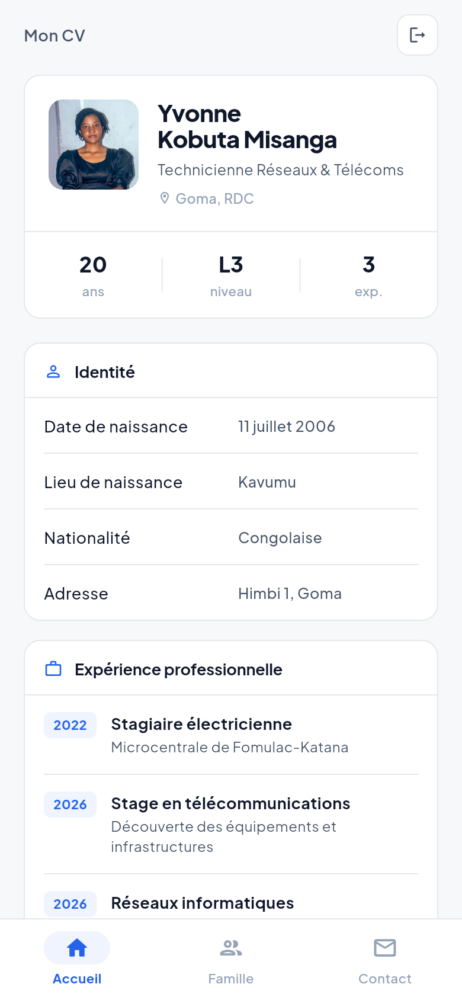
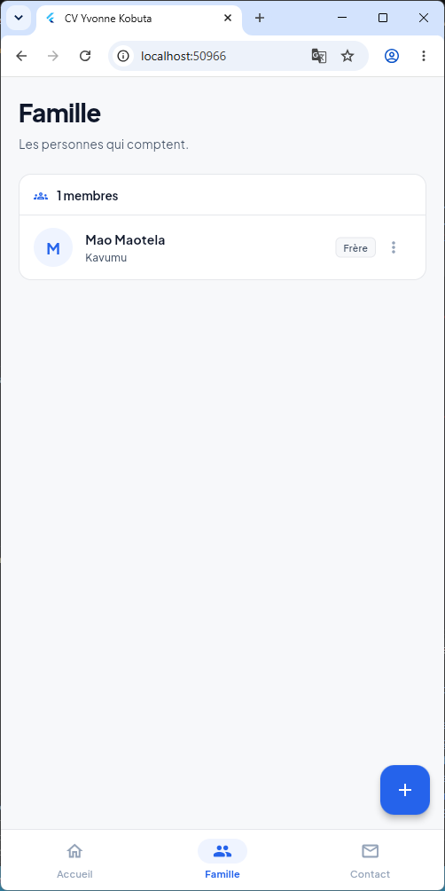
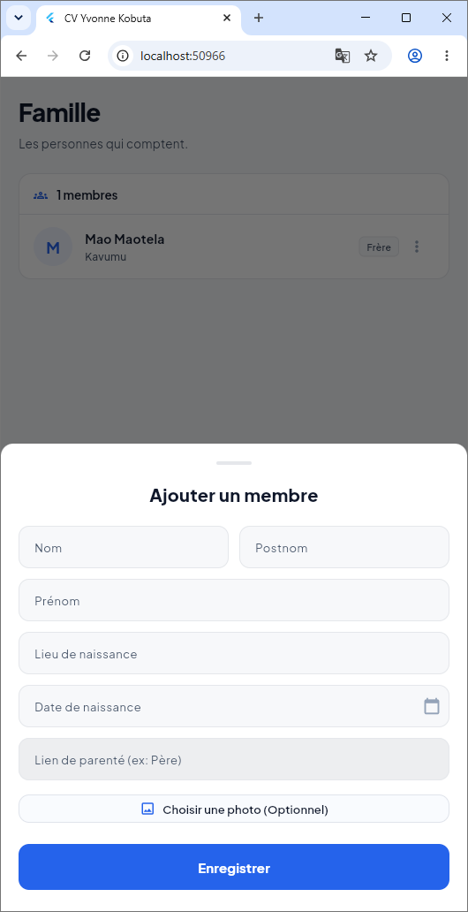
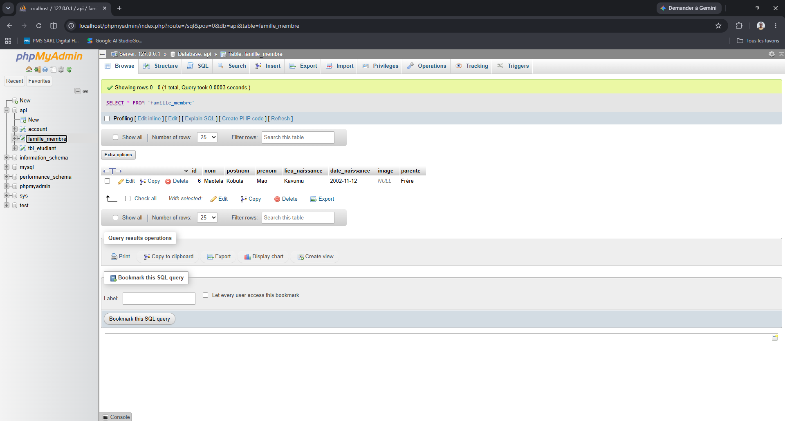

# CV Flutter – Yvonne Kobuta Misanga (Dynamique)

Application mobile Flutter complète présentant le CV de Yvonne Kobuta Misanga, avec authentification réelle et gestion dynamique des membres de la famille via une API REST et une base de données MySQL.

## Fonctionnalités

- **Authentification** : Connexion sécurisée via l'API (`/accounts/login`).
- **Accueil (CV)** : Affichage du profil, des chiffres clés, des informations personnelles, de l'expérience professionnelle, des compétences techniques, des langues et des centres d'intérêt.
- **Famille (CRUD)** : Ajout, consultation, modification et suppression des membres de la famille en temps réel (avec gestion des photos et sélection de la date de naissance).
- **Contact** : Coordonnées cliquables (téléphone, e-mail, WhatsApp, Instagram) grâce à `url_launcher`.
- **Navigation** : Barre de navigation fluide (Accueil, Famille, Contact) et bouton de déconnexion.

## Identifiants de test

Pour vous connecter, utilisez un compte créé via l'API :
| Identifiant (Email) | Mot de passe |
|-------------|--------------|
| `yvonne@exemple.com` | `yvonne2026` |

*(Si ce compte n'existe pas dans votre base de données locale, créez-le via Postman en envoyant une requête POST sur `/accounts/register`)*.

## Configuration

### 1. Base de données & API (XAMPP)
1. Démarrez **Apache** et **MySQL** depuis XAMPP.
2. Ouvrez `http://localhost/phpmyadmin`, créez une base `api` et importez le fichier `api.sql`.
3. Placez le dossier `api-test` dans `C:\xampp\htdocs\`.
4. Copiez `.env.example` en `.env` et configurez vos identifiants.
5. L'API est accessible sur `http://localhost/api-test/public`.

### 2. Application Flutter
1. Clonez ce dépôt.
2. Exécutez `flutter pub get`.
3. Lancez l'application avec `flutter run`.

**Note pour l'émulateur Android** : L'URL de l'API est configurée sur `http://10.0.2.2/api-test/public`. Pour un appareil physique ou le web, modifiez la constante `kBaseUrl` dans `lib/main.dart` en conséquence.

## Captures d'écran

### 1. Page de connexion

### 2. Page d'accueil (CV)

| Profil & identité | Expérience | Compétences, langues & intérêts |
|:---:|:---:|:---:|
|  |  |  |

### 3. Page Famille (Dynamique API)

**Liste des membres (API) :**

**Formulaire d'ajout / modification :**

### 4. Page Contact

### 5. Base de données MySQL (phpMyAdmin)

---

## Démonstration Vidéo

*Voici la vidéo montrant la communication entre l'application Flutter, l'API et la base de données MySQL.*

<video src="screenshots/video_demo.mp4" controls="controls" style="max-width: 100%;">
Votre navigateur ne supporte pas la balise vidéo.
</video>

*Si la vidéo ne s'affiche pas, vous pouvez la télécharger ici : [Vidéo de démonstration](screenshots/video_demo.mp4)*

## Technologies

- Flutter / Dart (Material 3)
- `http` : Requêtes API
- `google_fonts` : Police Plus Jakarta Sans
- `url_launcher` : Appels, e-mails et liens
- `image_picker` : Sélection d'images
- `intl` : Formatage de la date

## Auteur

**Yvonne Kobuta Misanga** – Technicienne Réseaux & Télécoms, Goma (RDC)