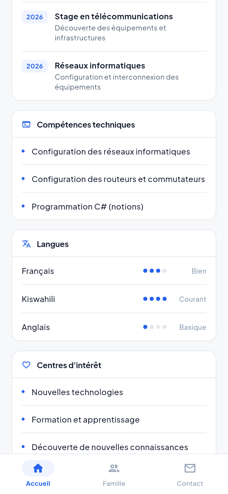
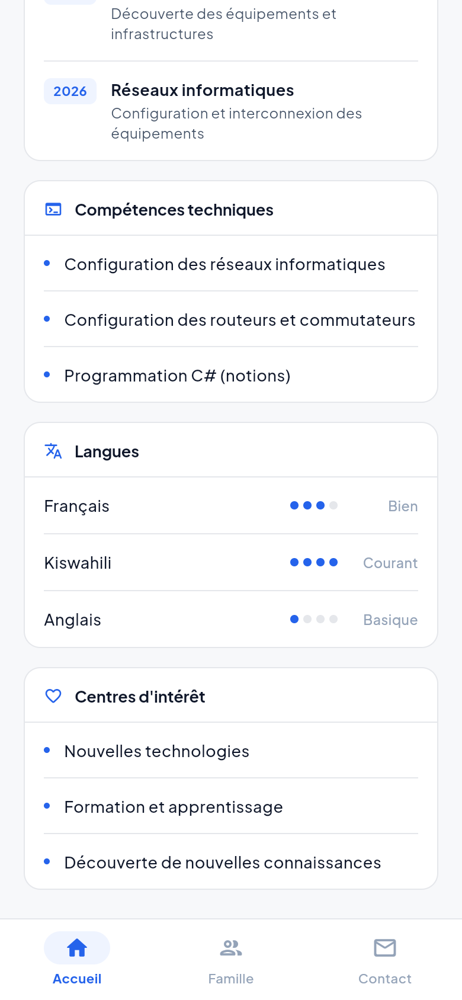
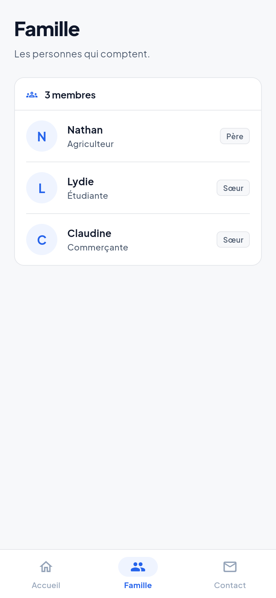
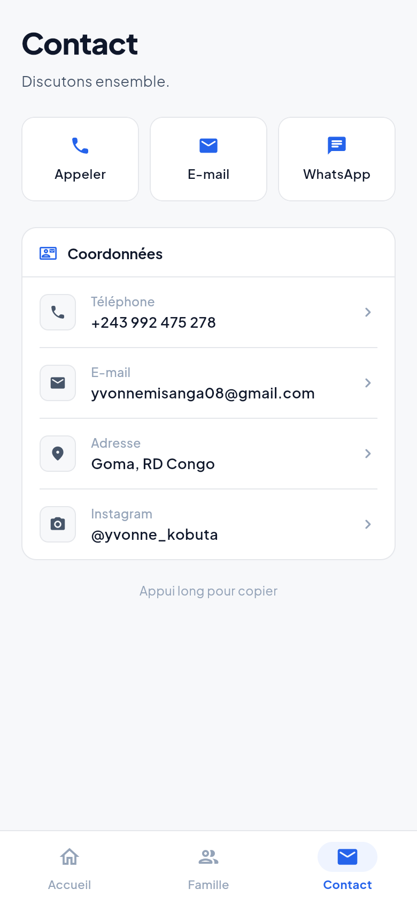

# CV Flutter – Yvonne Kobuta Misanga

Application mobile Flutter qui présente mon CV, ma famille et mes coordonnées.
L'accès à l'application se fait par une page de connexion.

## Fonctionnalités

- **Connexion** : formulaire avec identifiant, mot de passe masqué (affichable via l'icône œil) et bouton « Se connecter ».
- **Accueil (CV)** : photo, nom, titre, chiffres clés, identité, expérience professionnelle, compétences techniques, langues avec leur niveau et centres d'intérêt.
- **Famille** : les membres de ma famille avec leur nom, leur profession et leur lien de parenté.
- **Contact** : téléphone, e-mail, adresse et Instagram. Les boutons **Appeler**, **E-mail** et **WhatsApp** et les coordonnées sont cliquables grâce à `url_launcher`.
- **Navigation** : une barre de navigation en bas de l'écran (Accueil, Famille, Contact) et un bouton de déconnexion.

## Identifiants de test

| Identifiant | Mot de passe |
|-------------|--------------|
| `yvonne`    | `yvonne2026` |

## Captures d'écran

### 1. Page de connexion


### 2. Page d'accueil (CV)

| Profil & identité | Expérience | Compétences, langues & intérêts |
|:---:|:---:|:---:|
|  |  |  |

### 3. Page Famille



### 4. Page Contact



## Technologies

- Flutter / Dart (Material 3)
- [`google_fonts`](https://pub.dev/packages/google_fonts) : polices
- [`url_launcher`](https://pub.dev/packages/url_launcher) : appels, e-mails, WhatsApp et liens

## Lancer le projet

```bash
flutter pub get
flutter run
```

## Auteur

**Yvonne Kobuta Misanga** – Technicienne Réseaux & Télécoms, Goma (RDC)
